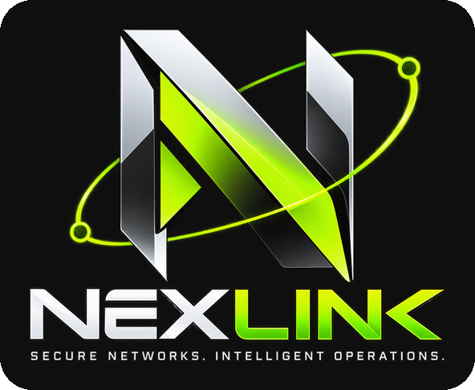
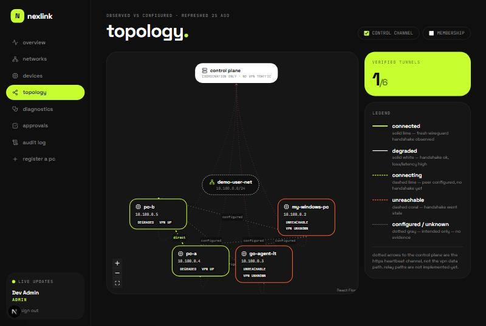
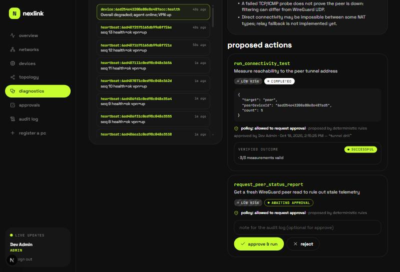
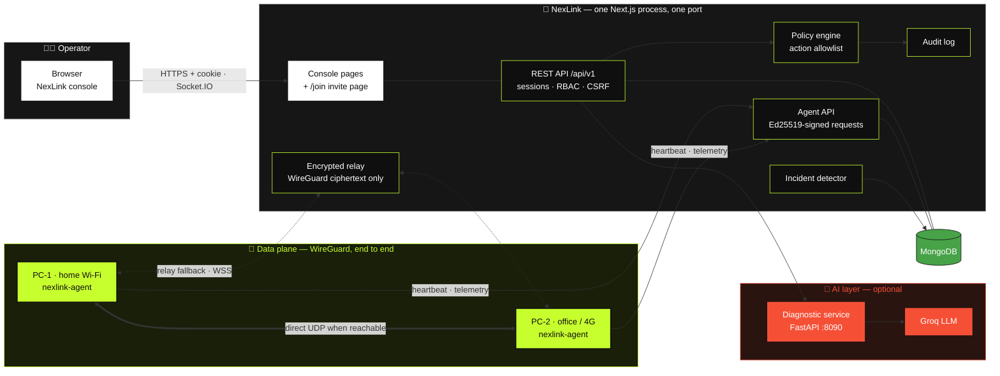
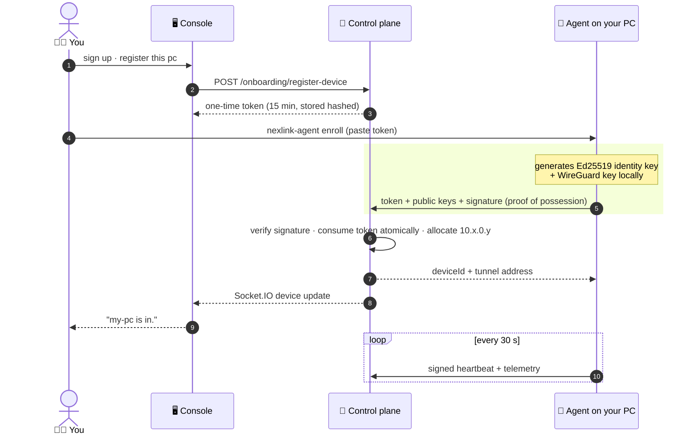
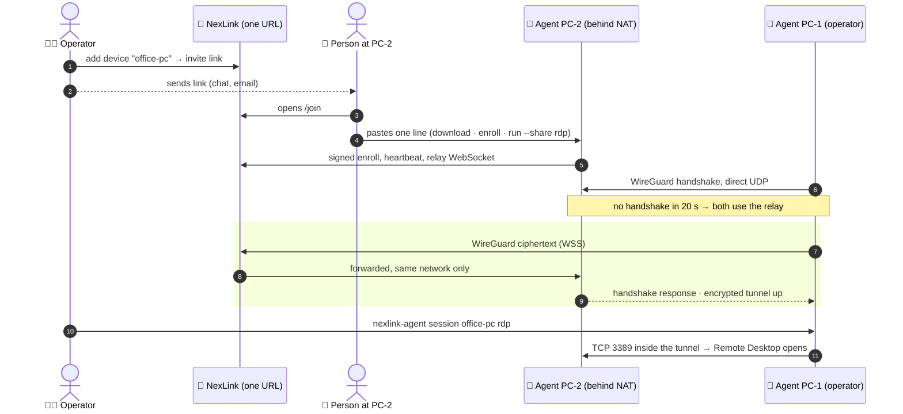
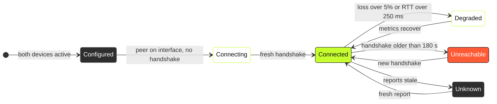
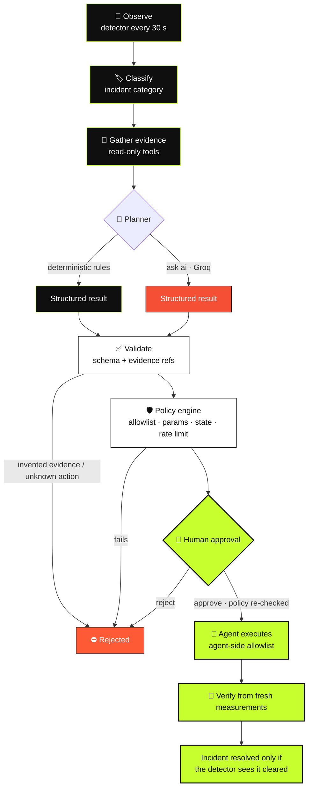
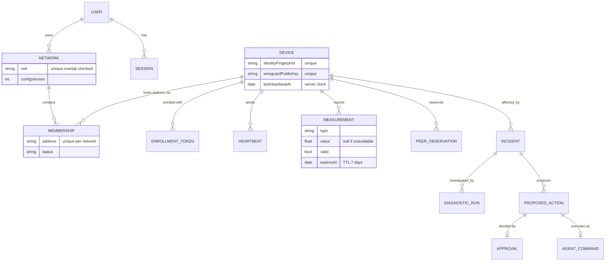

<div align="center">

<picture>
  <source media="(prefers-color-scheme: dark)" srcset="docs/images/logo.png" />
  
</picture>

**Private networking · evidence-based diagnostics · policy-gated remote ops**

*WireGuard tunnels, honest telemetry, and diagnostics that show their receipts.<br/>Nothing is marked connected until a handshake says so.*


</div>

---

## 📑 Contents

[Overview](#-overview) · [Features](#-features) · [Screenshots](#-screenshots) · [Architecture](#%EF%B8%8F-architecture) · [How it works](#-how-it-works) · [Quick start](#-quick-start) · [Testing](#-testing) · [Security](#%EF%B8%8F-security-model) · [Repository](#-repository-layout) · [Docs](#-documentation)

## ✨ Overview

NexLink lets you create private networks, invite computers from **anywhere**, watch real connectivity,
open **remote sessions** through encrypted tunnels, diagnose failures, and run **approved** remote actions
— all from one web app that deploys as a single process.

| | |
|---|---|
| 🌍 **Any network, any computer** | Send an invite link; whoever opens it pastes one line. Home Wi-Fi, office, hotel, mobile hotspot, CGNAT — devices connect directly when they can and through an **encrypted relay** when they can't. |
| 🔐 **Real VPN, not a dashboard** | Devices talk over **WireGuard**, end to end. Even through the relay, the server only forwards ciphertext it cannot read. |
| 🚀 **One app to deploy** | Console, REST API, live updates and relay are **one Next.js process on one port** — one container, one URL. |
| 🧾 **Honest state** | Agent liveness, interface state and tunnel handshakes are tracked **separately**. Missing data shows as *unknown / not measured* — never as `0` or "healthy". |
| 🧠 **AI with guardrails** | Diagnostics (rules or **Groq LLM**) must cite real evidence, can only propose allowlisted actions, and every action needs policy checks **and** a human yes. |
| 📜 **Audited** | Every security-sensitive operation is written to an append-only audit log by the backend. |

## 🧩 Features

| | Feature | What it gives you |
|:---:|---|---|
| 🙋 | **Sign up & register this PC** | Create an account, get your own private network and register the computer you're on in about a minute. |
| 🔢 | **Join with a code** | One line, identical for every computer and containing no secret. The computer creates its keys and shows a short code like `KXRT-4P2M`; you approve it in the console after checking the computer's name and key fingerprint. No tokens to copy, nothing to expire in a chat. |
| 🧭 | **Guided setup** | Three steps — create a network (free private range picked for you, CIDR optional), add devices, verify connectivity — with each check (agent, interface, peers, handshake, tested reachability) shown separately. |
| 🔭 | **Network observatory** | Per device: RTT, loss and throughput over 1 h–7 d with incidents, path changes and agent silences on the same time axis, plus a connection inspector for every peer pair — configured vs observed, direct vs relay, what each side reported. |
| 💌 | **Invite links** | Add a device and send the link. The invited person sees the right one-liner for Windows, macOS or Linux — no account, no admin rights, no WireGuard app. The token rides in the URL `#fragment`, which never reaches a server. |
| 🌐 | **Private networks** | Pick an IPv4 range; NexLink validates it, prevents overlaps and hands every device a unique virtual address. |
| 🪪 | **Cryptographic device identity** | Each PC generates its own Ed25519 identity. One-time enrollment tokens, signed requests, instant revocation. |
| 🔐 | **WireGuard data plane** | Devices talk directly over encrypted UDP. The agent can export a ready-to-import tunnel file for the WireGuard app. |
| 🖧 | **Join from anywhere in one minute** | One PowerShell or shell line downloads the agent, creates keys on that computer, enrolls and starts the tunnel — `run --userspace` carries WireGuard inside the agent. |
| 📡 | **Encrypted relay (NAT traversal)** | Each peer is tried directly first; if no handshake comes within 20 s the agent switches to `relay:<device>` — WireGuard packets inside the agent's signed WebSocket. Same-network only, rate-limited, cut the moment a device is revoked. The topology shows **direct** vs **relay** per link. |
| 🖥️ | **Remote sessions** | The device owner opts in with `--share rdp,ssh` (or picks it on the invite page). Operators run `nexlink-agent session pc-2 rdp` — Remote Desktop opens through the tunnel, from any network. Both agents log every session to their console in the portal. |
| 💓 | **Live, honest health** | Agent liveness, interface state and tunnel handshakes are tracked separately; RTT, jitter and loss are measured through the tunnel. |
| 🕸️ | **Interactive topology** | A live map that tells *configured* links apart from links WireGuard has actually confirmed. |
| 🎬 | **Protocol simulation** | An animated replay of the two-PC tunnel — enrollment, peer config, the WireGuard handshake (148 B / 92 B), encrypted probes and telemetry — with failure scenarios (packet loss, peer offline, control plane down, revocation), a packet inspector and the real link state of your own devices alongside. |
| 🩺 | **Automatic diagnostics** | Incidents are detected from real observations; read-only tools collect evidence; diagnosis by rules or AI. |
| ✨ | **AI insights** | Every network gets an AI briefing on the overview: what is healthy, what is failing, the likely causes and what the AI could not tell — each finding cites the recorded evidence it is based on, and invented citations are rejected. Alongside it, analytics computed from agent records: health score, direct vs relayed tunnels, 24 h latency and loss, incident trends and mean time to resolve. |
| 🤖 | **AI with guardrails** | Groq-powered diagnosis must cite collected evidence and can only propose allowlisted actions. One click on any device — **analyze with AI** — gives a grounded health analysis that can explain but never act. |
| ✅ | **Approve, execute, verify** | Every action needs a human yes, runs on the agent, and is verified from fresh measurements. |
| 📜 | **Audit log** | Every security-sensitive operation is recorded by the backend and searchable in the console. |
| 🖥️ | **Agent console in the browser** | Each device page streams the agent's own output live, and **run on this device** buttons send approved commands and show the verified result. |
| ⚙️ | **Runs in the background** | `nexlink-agent install` turns the agent into a Windows service that starts with the PC — no terminal needed. |
| 🧰 | **Agent toolkit** | `enroll` · `run` · `install` · `doctor` · `export-config` · `lab` · `probe` — from first enrollment to troubleshooting. |

## 📸 Screenshots

| Topology: two devices connected over WireGuard | Approved connectivity test, verified through the tunnel |
|---|---|
|  |  |

## 🏗️ Architecture



> VPN packets take the thick lime link when the two networks allow it, and the dotted relay path when they
> don't. Either way they are WireGuard-encrypted between the two agents: the server coordinates keys,
> addresses and policy, and at most forwards ciphertext it holds no key for.

### Four layers of "is it connected?"

| Layer | Meaning | Evidence |
|---|---|---|
| 1️⃣ Registered | identity key enrolled | `devices.enrollmentState = enrolled` |
| 2️⃣ Configured | desired peers computed | `networks.configVersion`, `GET /agent/config` |
| 3️⃣ Tunnel up | WireGuard completed a handshake | last handshake ≤ 180 s at report time |
| 4️⃣ Reachable | packets cross the tunnel | TCP probe to the peer's tunnel address |

None of these is inferred from the one above it.

## 🔄 How it works

### 🪪 Enrolling a PC



### 🌍 Invite → tunnel → remote session, across any networks



### 🚦 Peer link states (what the topology draws)



### 🩺 Diagnostic loop with human-in-the-loop



### 🗃️ Data model (MongoDB)



Integrity rules live in the database as unique / partial / TTL indexes — see [docs/database-schema.md](docs/database-schema.md).

## 🚀 Quick start

**Prerequisites:** Node 20+. That's it for the core — MongoDB is embedded in development, and the agent
downloads come from `scripts/build-agent.ps1` (Go 1.22+ only needed to rebuild them).

```bash
cd web
cp .env.example .env
npm install
npm run dev                # http://localhost:3000 → sign up (first account becomes admin)
```

One process serves the console, the API, live updates and the relay. Click **register this pc**, paste the
line it shows into PowerShell (or a terminal on macOS/Linux) — done.

**Invite another computer, anywhere:** devices → **add a device** → copy the invite link and send it. For
computers outside your LAN the portal has to be reachable from the internet:

```bash
docker compose up -d --build          # NexLink + MongoDB; put HTTPS in front and set PUBLIC_URL
```

or run the `Dockerfile` on Render / Railway / Fly.io / any VPS with `MONGODB_URI` (e.g. Atlas) and
`PUBLIC_URL`. Full guide: **[docs/deploy.md](docs/deploy.md)**.

<details>
<summary>🖥️ Open a remote session</summary>

On the computer you want to reach, pick **allow remote sessions: remote desktop** on the invite page (or
start its agent with `--share rdp`). Then, on your own enrolled PC:

```powershell
& "$env:LOCALAPPDATA\NexLink\nexlink-agent.exe" session office-pc rdp
```
The device page shows the exact command, whether the link is **direct** or **relay**, and the session log.
</details>

<details>
<summary>🐹 Build the agent yourself</summary>

```powershell
.\scripts\build-agent.ps1     # Windows, Linux (x64/ARM64), macOS (Intel/Apple silicon) → web/public/downloads
```
</details>

<details>
<summary>🤖 Enable AI (Groq)</summary>

Add `GROQ_API_KEY=<your key>` to `web/.env` and restart — the AI provider is built into the app, so there is
nothing else to run or deploy. Only evidence summaries are sent to Groq, never keys, tokens or raw payloads.
The separate Python `diagnostic-service` remains available via `DIAGNOSTIC_SERVICE_URL` if you prefer it.
</details>

## 🧪 Testing

| Suite | Command | Result | Category |
|---|---|:---:|---|
| 🧭 Web app + control plane | `cd web && npm test` | ✅ 85 / 85 | integration vs ephemeral MongoDB + simulated agents with real keys; relay over real WebSockets |
| 🐹 Go agent | `cd networking-agent && go test ./...` | ✅ 28 / 28 | unit + real wireguard-go tunnels on loopback, incl. one whose **only** path is the relay; session gateway end to end |
| 🐹 Agent ↔ control plane | `go test -tags integration ./tests/` | ✅ passed | real agent vs running control plane |
| 🤖 Diagnostic service | `cd diagnostic-service && python -m pytest -q` | ✅ 15 / 15 | contract tests, Groq mocked |
| 🔐 WireGuard tunnel | `nexlink-agent lab --a <dirA> --b <dirB>` | ✅ connected | real WireGuard protocol between two enrolled agents |

## 🛡️ Security model

- 🍪 Sessions in **HttpOnly, SameSite=Strict** cookies; CSRF token kept in memory only; scrypt password hashing; lockout + rate limits.
- 🪪 Devices prove identity with **Ed25519** — every agent request is signed and replay-protected; device id comes from the signature, not the body.
- 🔑 Private keys **never leave the device** and are never stored in the database.
- 🛡️ RBAC enforced in the backend; out-of-scope resources return 404.
- 🧱 Agent is **read-only by default**; host changes need `NEXLINK_ENABLE_PRIVILEGED=true` locally *and* an approved command.
- 📡 The relay forwards WireGuard ciphertext only, between devices of the same network, rate-limited per device; revocation closes the socket at once.
- 🖥️ Nothing is shared for remote sessions unless the device's owner opts in; shared services listen on the tunnel address only.
- 🤖 AI output is untrusted input: strict schema, evidence grounding, action allowlist, policy engine, human approval, agent-side allowlist.

Full analysis: [docs/threat-model.md](docs/threat-model.md).

## 📁 Repository layout

```text
nexlink/
├── 🧭 web/                 the NexLink app — one Next.js process, one port
│   ├── app/ features/ …    console, invite page, join scripts (Tailwind, React Flow, Socket.IO)
│   ├── server/             control plane: auth, networks, enrollment, telemetry, incidents, policy, audit, relay
│   └── server.js           serves all of it together
├── 🐹 networking-agent/    Go agent: identity, signed transport, WireGuard, probes, executor, doctor
├── 🤖 diagnostic-service/  FastAPI: diagnostic contracts, mock + Groq providers, grounding validator
├── 📚 docs/                architecture, threat model, protocols, API, schema, roadmap, two-PC runbook
├── 🐳 Dockerfile           one image: app + agent downloads for every OS
└── 🐳 docker-compose.yml   NexLink + MongoDB (+ optional AI service)
```

## 📚 Documentation

| Doc | What's inside |
|---|---|
| [architecture.md](docs/architecture.md) | components, health model, diagnostic loop, MongoDB constraints |
| [network-protocols.md](docs/network-protocols.md) | enrollment, request signing, telemetry v1, probes, NAT/relay design |
| [api-contracts.md](docs/api-contracts.md) | every REST endpoint with permissions |
| [database-schema.md](docs/database-schema.md) | collections, indexes, retention |
| [threat-model.md](docs/threat-model.md) | threats, mitigations, known gaps |
| [deploy.md](docs/deploy.md) | put NexLink on the internet: Docker, PaaS, HTTPS, PUBLIC_URL |
| [two-pc-test.md](docs/two-pc-test.md) | step-by-step guide to connect two PCs, on one network or on two |
| [run-commands.md](docs/run-commands.md) | start each part by hand, demo data, quick fixes |
| [NexLink-Page-Script.pdf](docs/NexLink-Page-Script.pdf) | every console page: what it shows and how to explain it |
| [NexLink-Demo-Guide.pdf](docs/NexLink-Demo-Guide.pdf) | full presentation script with commands |

<div align="center">
<sub>Built with 🟢 electric lime · #C7FF2E</sub>
</div>
