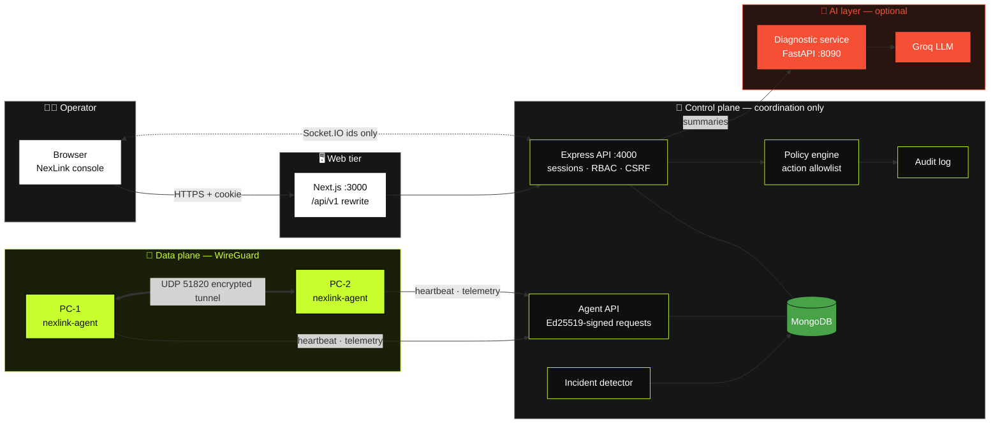
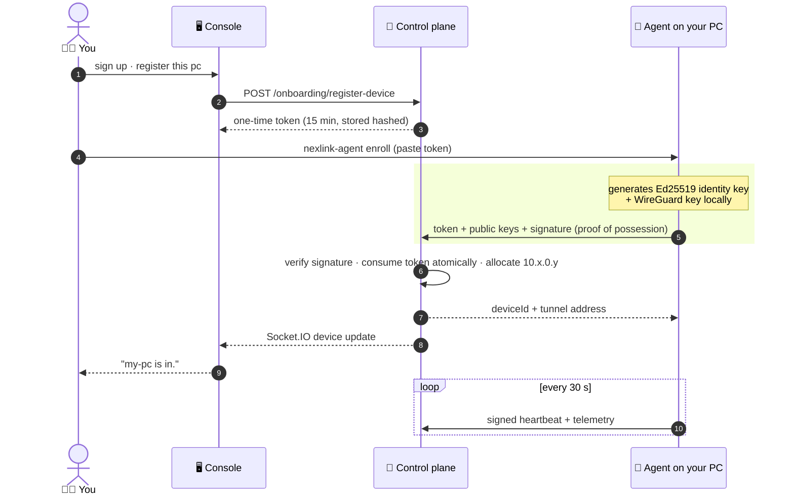
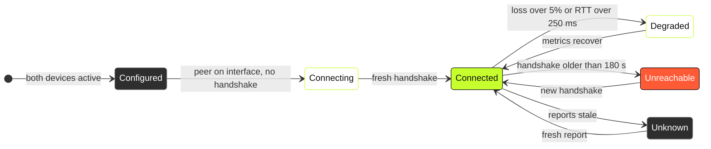
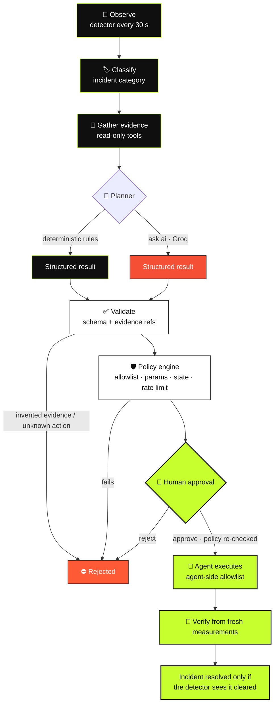

<div align="center">

# 🟢 NexLink

**Private networking · evidence-based diagnostics · policy-gated remote ops**

*WireGuard tunnels, honest telemetry, and diagnostics that show their receipts.<br/>Nothing is marked connected until a handshake says so.*


</div>

---

## 📑 Contents

[Overview](#-overview) · [Status](#-project-status) · [Architecture](#%EF%B8%8F-architecture) · [How it works](#-how-it-works) · [Quick start](#-quick-start) · [Testing](#-testing) · [Security](#-security-model) · [Repository](#-repository-layout) · [Docs](#-documentation) · [Roadmap](#%EF%B8%8F-roadmap)

## ✨ Overview

NexLink lets you create private networks, enroll your own computers, watch real connectivity, diagnose
failures, and run **approved** remote actions from a web console.

| | |
|---|---|
| 🔐 **Real VPN, not a dashboard** | Devices talk over **WireGuard**. The web server never carries tunnel traffic — control plane and data plane are separate. |
| 🧾 **Honest state** | Agent liveness, interface state and tunnel handshakes are tracked **separately**. Missing data shows as *unknown / not measured* — never as `0` or "healthy". |
| 🧠 **AI with guardrails** | Diagnostics (rules or **Groq LLM**) must cite real evidence, can only propose allowlisted actions, and every action needs policy checks **and** a human yes. |
| 📜 **Audited** | Every security-sensitive operation is written to an append-only audit log by the backend. |

## 📊 Project status

> **Legend:** ✅ done & tested  ·  🟡 built, partially verified  ·  ⏳ ready, waiting on a manual run  ·  ❌ not started

| Area | Status | Evidence |
|---|:---:|---|
| 🔑 Login, HttpOnly sessions, CSRF, lockout, RBAC (admin / operator / viewer), scoped access | ✅ | `control-plane/tests/auth.test.js` |
| 🙋 Self-service **sign up** + **register this PC** onboarding | ✅ | `signup.test.js` + browser check |
| 🌐 Networks: CIDR validation, overlap rejection (incl. races), DB-enforced unique addresses | ✅ | `networks.test.js`, `ipv4.test.js` |
| 🪪 Enrollment: one-time hashed tokens, Ed25519 proof-of-possession, replay/expiry/duplicate rejection, revocation | ✅ | `enrollment.test.js` |
| ✍️ Signed agent protocol (timestamp window, nonce replay guard, body integrity) | ✅ | Node tests + Go↔Node signature test vector |
| 💓 Heartbeats, telemetry schema v1, health model, observed-vs-configured topology | ✅ | `telemetry.test.js` |
| 🩺 Incident detection → evidence → diagnosis → policy → approval → execution → verification | ✅ | `incidents.test.js` |
| 📜 Append-only audit log (searchable) | ✅ | `incidents.test.js`, `auth.test.js` |
| 🖥️ Next.js console (overview, networks, devices, topology, diagnostics, approvals, audit, setup) | ✅ | production build + browser walkthrough |
| 🐹 Go agent: enroll, heartbeat, telemetry, TCP probes, command executor, WireGuard inspector/applier | ✅ | 18 Go tests + live integration test |
| 🧰 `export-config`, `doctor`, tunnel probe responder, LAN endpoint ranking | 🟡 | verified with two agents on one PC |
| 🔗 Real WireGuard tunnel between **two PCs** | ⏳ | follow [docs/two-pc-test.md](docs/two-pc-test.md) |
| 🤖 Groq LLM diagnostics ("ask ai") | 🟡 | 15 Python tests with mocked Groq; live call needs your `GROQ_API_KEY` |
| 🛰️ NAT traversal / relay fallback | ❌ | designed in [docs/network-protocols.md](docs/network-protocols.md) |
| 🔒 TLS deployment guide, OS keychain key storage, MFA | ❌ | [roadmap](#%EF%B8%8F-roadmap) |

## 🏗️ Architecture



> The thick lime link is the **only** path VPN packets take. The control plane coordinates keys, addresses
> and policy — it never sees tunnel traffic.

### Five layers of "is it connected?"

| Layer | Meaning | Evidence |
|---|---|---|
| 1️⃣ Registered | identity key enrolled | `devices.enrollmentState = enrolled` |
| 2️⃣ Configured | desired peers computed | `networks.configVersion`, `GET /agent/config` |
| 3️⃣ Tunnel up | WireGuard completed a handshake | last handshake ≤ 180 s at report time |
| 4️⃣ Reachable | packets cross the tunnel | TCP probe to the peer's tunnel address |
| 5️⃣ App works | a service on the peer answers | *not measured yet* |

None of these is inferred from the one above it.

## 🔄 How it works

### 🪪 Enrolling a PC



### 🚦 Peer link states (what the topology draws)



### 🩺 Diagnostic loop with human-in-the-loop



### 🗃️ Data model (MongoDB)


Integrity rules live in the database as unique / partial / TTL indexes — see [docs/database-schema.md](docs/database-schema.md).

## 🚀 Quick start

**Prerequisites:** Node 20+, Python 3.11+ (only for AI diagnostics). MongoDB is optional — `npm run dev:mongo`
starts a local one, or point `MONGODB_URI` at Docker / Atlas. Go is only needed to rebuild the agent.

```bash
# 1 · control plane  (terminal A + B)
cd control-plane
cp .env.example .env
npm install
npm run dev:mongo          # A: dev-only MongoDB on 127.0.0.1:27017
npm run dev                # B: http://localhost:4000

# 2 · console  (terminal C)
cd frontend
cp .env.example .env.local
npm install
npm run dev                # http://localhost:3000 → sign up (first account becomes admin)
```

Then **register a pc** in the console and, in an **Administrator** PowerShell:

```powershell
cd networking-agent\bin
.\nexlink-agent.exe enroll --server http://localhost:4000   # paste the token
.\nexlink-agent.exe run
```

<details>
<summary>🐹 Build the agent yourself</summary>

```bash
cd networking-agent
go build -o bin/nexlink-agent.exe ./cmd/nexlink-agent
```
</details>

<details>
<summary>🤖 Enable "ask ai" with Groq</summary>

```powershell
cd diagnostic-service
python -m venv .venv; .venv\Scripts\pip install -r requirements.txt
$env:NEXLINK_DIAG_PROVIDER="groq"; $env:GROQ_API_KEY="<your key>"
.venv\Scripts\python -m uvicorn app.api.main:app --host 127.0.0.1 --port 8090
```
Set `DIAGNOSTIC_SERVICE_URL=http://127.0.0.1:8090` in `control-plane/.env`. Only evidence summaries are sent to Groq.
</details>

<details>
<summary>🔗 Connect two PCs over WireGuard</summary>

Step-by-step, including Windows firewall commands: **[docs/two-pc-test.md](docs/two-pc-test.md)**.
`nexlink-agent export-config` writes the tunnel file for the WireGuard app; `nexlink-agent doctor` tells you exactly what is missing.
</details>

## 🧪 Testing

| Suite | Command | Result | Category |
|---|---|:---:|---|
| 🧭 Control plane | `cd control-plane && npm test` | ✅ 57 / 57 | integration vs ephemeral MongoDB + simulated agent with real keys |
| 🐹 Go agent | `cd networking-agent && go test ./...` | ✅ 18 / 18 | unit (loopback only, no host changes) |
| 🐹 Agent ↔ control plane | `go test -tags integration ./tests/` | ✅ passed | real agent vs running control plane |
| 🤖 Diagnostic service | `cd diagnostic-service && python -m pytest -q` | ✅ 15 / 15 | contract tests, Groq mocked |
| 🔗 Two-PC WireGuard | [docs/two-pc-test.md](docs/two-pc-test.md) | ⏳ pending | separate physical machines |

## 🛡️ Security model

- 🍪 Sessions in **HttpOnly, SameSite=Strict** cookies; CSRF token kept in memory only; scrypt password hashing; lockout + rate limits.
- 🪪 Devices prove identity with **Ed25519** — every agent request is signed and replay-protected; device id comes from the signature, not the body.
- 🔑 Private keys **never leave the device** and are never stored in the database.
- 🛡️ RBAC enforced in the backend; out-of-scope resources return 404.
- 🧱 Agent is **read-only by default**; host changes need `NEXLINK_ENABLE_PRIVILEGED=true` locally *and* an approved command.
- 🤖 AI output is untrusted input: strict schema, evidence grounding, action allowlist, policy engine, human approval, agent-side allowlist.

Full analysis: [docs/threat-model.md](docs/threat-model.md).

## 📁 Repository layout

```text
nexlink/
├── 🖥️ frontend/            Next.js console (JavaScript, Tailwind, React Flow, Socket.IO)
├── 🧭 control-plane/       Express + MongoDB: auth, networks, enrollment, telemetry, incidents, policy, audit
├── 🐹 networking-agent/    Go agent: identity, signed transport, WireGuard, probes, executor, doctor
├── 🤖 diagnostic-service/  FastAPI: diagnostic contracts, mock + Groq providers, grounding validator
├── 📚 docs/                architecture, threat model, protocols, API, schema, roadmap, two-PC runbook
└── 🐳 docker-compose.yml   MongoDB (+ optional control plane / diagnostic service)
```

## 📚 Documentation

| Doc | What's inside |
|---|---|
| [architecture.md](docs/architecture.md) | components, health model, diagnostic loop, MongoDB constraints |
| [network-protocols.md](docs/network-protocols.md) | enrollment, request signing, telemetry v1, probes, NAT/relay design |
| [api-contracts.md](docs/api-contracts.md) | every REST endpoint with permissions |
| [database-schema.md](docs/database-schema.md) | collections, indexes, retention |
| [threat-model.md](docs/threat-model.md) | threats, mitigations, known gaps |
| [two-pc-test.md](docs/two-pc-test.md) | runbook for the first real tunnel |
| [implementation-roadmap.md](docs/implementation-roadmap.md) | stage status and test categories |

## 🗺️ Roadmap

- [x] Secure control plane, MongoDB, auth, RBAC, audit
- [x] Enrollment, signed agent protocol, telemetry, honest health model
- [x] Deterministic incidents, policy engine, approvals, verification
- [x] Go agent built and integration-tested
- [x] Groq provider behind guardrails
- [ ] 🔗 First real two-PC WireGuard tunnel ([runbook](docs/two-pc-test.md))
- [ ] 🤖 Live Groq diagnosis review with a real key
- [ ] 🛰️ Relay fallback + NAT traversal for PCs behind different routers
- [ ] 🔒 TLS deployment guide, OS keychain key storage, MFA

<div align="center">
<sub>Built with 🟢 electric lime · #C7FF2E</sub>
</div>
# nexlinkk

